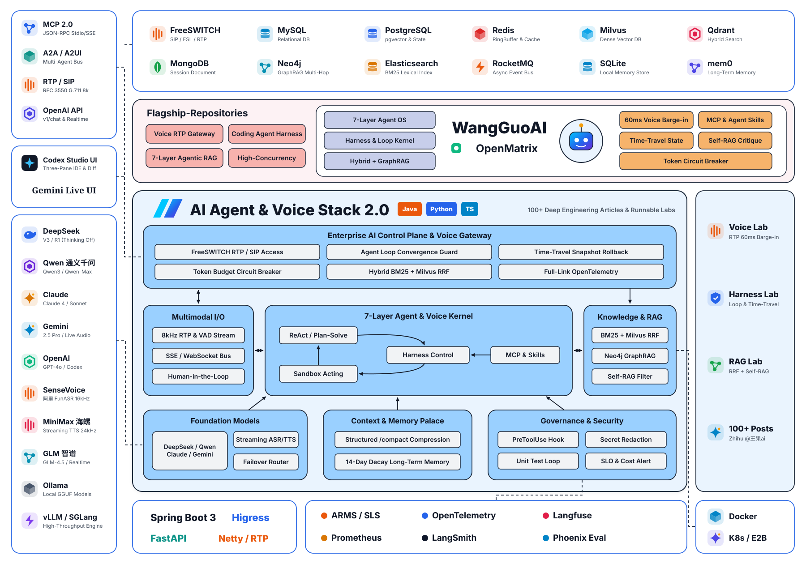

<div align="center">

# 🎙️ AI Agent 与实时语音工程全景实战手册
### (Coding Agent Harness · AI Agent Architecture · Agentic RAG · Voice Agent Full-Stack Guide)

[](https://www.zhihu.com/people/wang-guo-ha-53)
[](https://www.zhihu.com/people/wang-guo-ha-53/posts)
[](https://github.com/wangguode/AI-Agent-and-Voice-Engineering/stargazers)

> **从架构原理到生产级落地**：本仓库是 **王果（知乎 [@王果ai](https://www.zhihu.com/people/wang-guo-ha-53)，1.2 万关注）** 的开源知识库与可运行代码实验室，涵盖 **Voice Agent 实时语音机器人全栈架构**、**Codex / Claude Code 式编码智能体与 Harness/Loop Engineering**、**AI Agent 七层工程架构（29 讲）**、**企业级 RAG 七层模型（10 讲）** 以及 **百万架构师高并发实战（24 讲）**。

</div>

---

## 🧭 核心架构视图与旗舰实战项目 (Architecture & Flagship Repos)

<p align="center">
  <picture>
    <source media="(prefers-color-scheme: dark)" srcset="./docs/assets/architecture-dark.svg">
    <source media="(prefers-color-scheme: light)" srcset="./docs/assets/architecture-light.svg">
    
  </picture>
</p>

| 旗舰独立仓库 | 技术栈 | 开箱即用核心能力 |
| :--- | :--- | :--- |
| 📞 [**voice-agent-rtp-gateway**](https://github.com/wangguode/voice-agent-rtp-gateway) | **Java 17 (Spring Boot 3)** + **Python (Pipecat 1.15)** | FreeSWITCH 8kHz RTP/WebSocket 边缘网关 + 实时语音监控大屏 (`WG Voice Gateway Console`) + 60ms 毫秒级 `clearAudio` 打断 + DeepSeek/SenseVoice 接入 |
| 🧩 [**coding-agent-harness-patterns**](https://github.com/wangguode/coding-agent-harness-patterns) | **Java 17 (Spring Boot 3)** + **Python 零依赖 CLI** | 编码智能体可视化工作台 (`WG Harness Studio`) + Agent Loop 单测自修复闭环 + HITL 人工审批拦截 + `/compact` 压缩 + MCP JSON-RPC 2.0 沙箱 |

---

## 🧪 可运行代码实验室 (Runnable Labs)

> 每篇核心文章配一份**零依赖、可直接运行**的脱敏实现（仅需 Python 3.9+ / JDK 11+），读完文章即可跑通原理。

| Lab | 对应知乎文章 | 核心能力 | 运行 |
| :--- | :--- | :--- | :--- |
| [01-voice-agent-rtp-bargein](./01-voice-agent-rtp-bargein) | 语音机器人篇(3)(4) | RFC 3550 RTP 解析 · RMS VAD · 全双工状态机 · 60ms 打断 | `python3 01-voice-agent-rtp-bargein/bargein_voice_engine.py` |
| [02-harness-loop-kernel](./02-harness-loop-kernel) | 特别篇六 Harness & Loop Engineering | 死循环收敛检测 · Token 账单熔断 · 时间旅行快照回滚 | `python3 02-harness-loop-kernel/harness_kernel.py` |
| [03-seven-layer-agentic-rag](./03-seven-layer-agentic-rag) | RAG 篇(1~10) | BM25 + 稠密向量 RRF 融合 · Self-RAG 自省过滤 | `python3 03-seven-layer-agentic-rag/hybrid_self_rag.py` |

```bash
git clone https://github.com/wangguode/AI-Agent-and-Voice-Engineering.git
cd AI-Agent-and-Voice-Engineering
python3 02-harness-loop-kernel/harness_kernel.py   # 30 秒看懂 Harness 如何拦截 Agent 死循环
javac -d out 01-voice-agent-rtp-bargein/RtpBargeInController.java   # Java 版 RTP 打断控制器
```

---

## 📖 目录导航 (Table of Contents)

1. [模块一：Voice Agent · 语音机器人全栈工程实战（6 篇）](#-模块一voice-agent--语音机器人全栈工程实战)
2. [模块二：Harness Engineering、编码智能体与前沿特别篇（10 篇）](#-模块二harness-engineering编码智能体与前沿特别篇)
3. [模块三：工业级 AI Agent 架构体系全集（第 1~29 讲）](#-模块三工业级-ai-agent-架构体系全集第-129-讲)
4. [模块四：企业级 RAG 七层模型与深度检索（14 篇）](#-模块四企业级-rag-七层模型与深度检索)
5. [模块五：LLM 底层原理、推理优化与训练对齐（8 篇）](#-模块五llm-底层原理推理优化与训练对齐)
6. [模块六：百万架构师成长之路 & 代码之外的广阔星河（32 篇）](#-模块六百万架构师成长之路--代码之外的广阔星河)

---

## 🎙️ 模块一：Voice Agent · 语音机器人全栈工程实战

聚焦实时语音交互“死亡三角”（**高并发音频流、端到端超低延迟、自然打断与情绪感知**），从 FreeSWITCH/SIP 底层协议到 Java RTP 流式 ASR 与 Voice Agent 全栈架构：

| 序号 | 章节标题 | 核心技术点 | 阅读链接 |
| :--- | :--- | :--- | :--- |
| **01** | **Agent-语音机器人篇(1)：冰与火之歌——语音交互的旧时代挽歌与新纪元序曲** | 传统 IVR vs 大模型原生 Voice Agent 范式演进 | [知乎专栏](https://zhuanlan.zhihu.com/p/1955339374104383609) |
| **02** | **Agent-语音机器人篇(2)：基石与罗盘——FreeSWITCH、SIP 与语音工程的核心知识** | SIP 信令协商、SDP 协议、媒体流路由架构 | [知乎专栏](https://zhuanlan.zhihu.com/p/1955345916404954856) |
| **03** | **Agent-语音机器人篇(3)：铸造脊梁——Java 实时接收 RTP 语音流，获取流式 ASR 文本的设计与实现** | RTP 解包、PCM 音频缓冲池、WebSocket 流式 ASR 对接 | [知乎专栏](https://zhuanlan.zhihu.com/p/1955704546715207012) |
| **04** | **Agent-语音机器人篇(4)：为 AI 注入灵魂——驯服语音交互“死亡三角”的 Java 工程实战** | 延迟、打断（Barge-in）、上下文同步与流式 TTS 协同 | [知乎专栏](https://zhuanlan.zhihu.com/p/1956393539408733399) |
| **05** | **Agent-语音机器人篇(5)：Voice Agent 全栈架构深度解析** | 端到端语音大模型 vs 级联流水线架构、生产级全栈拆解 | [知乎专栏](https://zhuanlan.zhihu.com/p/2081779542469906860) |
| **特别篇** | **Agent-语音机器人【特别篇】：深入浅出 FreeSWITCH——从核心架构到万线并发的电话机器人实战** | 万线并发调优、ESL 事件总线、高可用媒体集群 | [知乎专栏](https://zhuanlan.zhihu.com/p/1956057721393643855) |

---

## 🔥 模块二：Harness Engineering、编码智能体与前沿特别篇

围绕 Codex / Claude Code 等编码智能体背后的工程命题，深入探讨 **Harness Engineering（马具工程）**、**Loop 收敛性**、**企业控制平面** 与 **FDE（前线部署工程师）**：

- 🔥 **[Agent(特别篇六)：Harness Engineering 和 Loop Engineering —— 一部 Agent 工程的血泪史（479+ 赞）](https://zhuanlan.zhihu.com/p/2051682264325546663)**
- 🔥 **[Agent(特别篇七)：Graph Engineering 刷屏了，但先问一个问题：你的 Agent Loop 收敛过吗？](https://zhuanlan.zhihu.com/p/2064476217709949350)**
- **[Agent(特别篇二)：OpenClaw 深度解析：架构拆解、工具执行机制、记忆系统与 AI Agent 的演进方向](https://zhuanlan.zhihu.com/p/2015022604340209608)**
- **[Agent(特别篇三)：从 OpenClaw 到悟空：当 AI Agent 撞上企业控制平面——为什么 Agent 一进入企业，整个技术栈都变了？](https://zhuanlan.zhihu.com/p/2017546200744752678)**
- **[Agent(特别篇四)：Claude Code 源码泄露深度解析：51.2 万行 TypeScript 撕开的 Agent 工程真相](https://zhuanlan.zhihu.com/p/2022688581404168978)**
- **[Agent(特别篇五)：Vibe Coding 的工业化之路：当“感觉对了就写”撞上生产环境的铁墙](https://zhuanlan.zhihu.com/p/2051380716659909359)**
- **[Agent(特别篇一)：超越 Workflow：为什么全自主 Agent 才是未来？——Clawdbot 与 Moltbook 的激进实验](https://zhuanlan.zhihu.com/p/2001647274166604382)**
- **[Agent(特别篇八)：不聊技术，聊聊比尔·盖茨最近发布的文章——动荡的 AI 时代已经来临](https://zhuanlan.zhihu.com/p/2077186547003167612)**
- **[Agent(特别篇九)：当 AI 开始“替你深夜干活”，你的 API 账单还安全吗？](https://zhuanlan.zhihu.com/p/2097728410067924450)**
- **[FDE篇(1)：别把 FDE 当外包，AI 越会写代码，为什么“下场把事做成”的人越值钱？](https://zhuanlan.zhihu.com/p/2098564681535434974)**

---

## 🤖 模块三：工业级 AI Agent 架构体系全集（第 1~29 讲）

从服务化演进、推理范式（ReAct / Plan-and-Solve / Reflexion / ToT）、七层工程架构（Layer 1~Layer 7）到 Harness 内核与 Agent Skills 封装：

| 阶段 | 讲次与主题 | 核心内容 |
| :--- | :--- | :--- |
| **架构基石 (1~8)** | • [第 1 讲：从单体到微服务：LLM 应用的服务化架构演进之路](https://zhuanlan.zhihu.com/p/1975671287625045453)<br>• [第 2 讲：Agent 的“熔断降级”：构建高可用的 AI 软件系统](https://zhuanlan.zhihu.com/p/1975674016833496526)<br>• [第 3 讲：从 System 1 直觉到 System 2 逻辑——认知架构与工具协议演进](https://zhuanlan.zhihu.com/p/1978590179548763434)<br>• [第 4 讲：记忆的持久化——从“金鱼效应”到 MemGPT 的操作系统隐喻](https://zhuanlan.zhihu.com/p/1978597464522130904)<br>• 🔥 [第 5 讲：思维的链条：从 ReAct 到 Plan-and-Solve 深度解构推理引擎](https://zhuanlan.zhihu.com/p/1978602518809424460)<br>• [第 6 讲：Agent 的手与脚：从 Function Calling 到 MCP 协议与 Computer Use](https://zhuanlan.zhihu.com/p/1978915610802029064)<br>• [第 7 讲：赋予 AI 自省能力：Reflexion 模式与 Actor-Critic 架构](https://zhuanlan.zhihu.com/p/1978961774905676283)<br>• [第 8 讲：流工程宣言：为什么 Agentic Workflow 才是企业落地的唯一解？](https://zhuanlan.zhihu.com/p/1978971101427147288) | 高可用容错、MemGPT、ReAct、MCP 协议、Actor-Critic |
| **七层架构模型 (9~18)** | • [第 9 讲：原子计算层 (Layer 1) —— 逃离概率陷阱：代码、参数与模板的铁律](https://zhuanlan.zhihu.com/p/1979318875473588847)<br>• [第 10 讲：智能算子层 (Layer 2) —— 将 LLM 封装为无状态的纯函数算子](https://zhuanlan.zhihu.com/p/1979688047382635862)<br>• [第 11 讲：增强接入层 (Layer 3) —— 给缸中之脑装上义眼与机械臂](https://zhuanlan.zhihu.com/p/1980060715155993851)<br>• [第 12 讲：控制流层 (Layer 4) —— 用图论与 DSL 驯服混沌](https://zhuanlan.zhihu.com/p/1980063198834082116)<br>• [第 13 讲：状态管理层 (Layer 6) —— 持久化机制、状态机与时间旅行调试](https://zhuanlan.zhihu.com/p/1981120590208336264)<br>• [第 14 讲：交互协同层 (Layer 5) —— 异步通信、主动反问与 HITL 最佳实践](https://zhuanlan.zhihu.com/p/1981122068331376982)<br>• [第 15 讲：编排治理层 (Layer 7) —— 全链路追踪、成本监控与自动化评估体系](https://zhuanlan.zhihu.com/p/1981123535431815935)<br>• [第 16 讲：过渡篇：从拖拽编排到 Java 执行的思维跃迁](https://zhuanlan.zhihu.com/p/1981432757654660912)<br>• [第 17 讲：Workflow 实战（上）—— 从零构建“智能标书生成系统”的业务骨架](https://zhuanlan.zhihu.com/p/1986105045532567526)<br>• [第 18 讲：Workflow 实战（下）—— 状态持久化、人机交互与治理的工程落地](https://zhuanlan.zhihu.com/p/1986107591798039472) | Agent 七层架构、DSL 编排、Time-Travel 调试、HITL、Java 工程落地 |
| **高阶认知与内核 (19~29)** | • [第 19 讲：反思与进化 —— Reflection 模式](https://zhuanlan.zhihu.com/p/1986111488121934223)<br>• [第 20 讲：结构化思维 —— Tree of Thoughts (ToT) 与广度优先搜索的 Java 实现](https://zhuanlan.zhihu.com/p/1986115501240366434)<br>• [第 21 讲：记忆宫殿 —— 超越 Context Window：长短期记忆架构与用户画像进化](https://zhuanlan.zhihu.com/p/1986115917734761831)<br>• [第 22 讲：动态规划 —— Plan-and-Execute 模式与 Planner Agent](https://zhuanlan.zhihu.com/p/1986117203624469490)<br>• [第 23 讲：精密控制 —— 编译器思维：利用 Grammar 约束 LLM 输出](https://zhuanlan.zhihu.com/p/1986117910104650430)<br>• [第 24 讲：知识图谱增强 (GraphRAG) —— 从向量检索到多跳推理](https://zhuanlan.zhihu.com/p/1986118586692032058)<br>• [第 25 讲：混合检索实战 (Hybrid Search & Reranking) —— 打造工业级搜索引擎](https://zhuanlan.zhihu.com/p/1986119699008865744)<br>• [第 26 讲：自省式检索 (Self-RAG) —— 构建可信赖的 RAG 闭环](https://zhuanlan.zhihu.com/p/1986119891405783715)<br>• [第 27 讲：连接互联网 (Web Browsing Agent) —— 实时信息流的获取、清洗与防毒](https://zhuanlan.zhihu.com/p/1986120833261904705)<br>• [第 28 讲：Harness Engineering —— Agent OS 的真正内核：任务循环、状态、沙箱与自我验证](https://zhuanlan.zhihu.com/p/2069920445848204198)<br>• [第 29 讲：Agent Skills —— 把企业能力封装成可安装的软件包](https://zhuanlan.zhihu.com/p/2072106765785867888) | ToT、Grammar 约束、GraphRAG、Self-RAG、Harness 内核、Agent Skills |

**专题综述补充**：
- 🔥 [从链式思想到图状涌现：万字深度解析 LangChain 与 LangGraph 的思想演变与实战精髓](https://zhuanlan.zhihu.com/p/1957395470147118600)
- 🔥 [从“能聊”到“能干”：一部 AI Agent 的进化史——深度拆解 Function Calling、MCP 与 Anthropic Skills 的演进之路](https://zhuanlan.zhihu.com/p/78345307884)
- [不止是意图识别：AI 任务规划与路由的终极指南——解构 Agent、RAG 与 MoE](https://zhuanlan.zhihu.com/p/1956860862661890216)
- [万字长文：从 RAG 到自我进化，构筑工业级 Agent 智能体的星辰大海与坚实地基](https://zhuanlan.zhihu.com/p/1954971763659215394)

---

## 📚 模块四：企业级 RAG 七层模型与深度检索

- 🔥 [从检索到洞察：万字长文解构 DeepSearch、DeepResearch、Agentic RAG 与 Graph RAG 的革命之路](https://zhuanlan.zhihu.com/p/1954568343232190060)
- [万字长文深入剖析 RAG 全链路技术栈](https://zhuanlan.zhihu.com/p/1954311712074359565)
- [RAG 的终结与 Content Engineering 的局限：从 Claude Code“逆向工程”视角构建下一代企业级上下文工程实践](https://zhuanlan.zhihu.com/p/1962631484587357849)
- [RAG篇(1)：RAG 的星辰大海——从朴素检索到 Agentic 范式，重构企业级 RAG 的七层架构](https://zhuanlan.zhihu.com/p/1968042003657885583)
- [RAG篇(2)：智能总控的诞生——从意图识别到任务路由，深入 RAG 七层模型之意图层](https://zhuanlan.zhihu.com/p/1968045755324408466)
- [RAG篇(3)：LLM 原生 OCR 革命——从文字识别到 DeepSeek-OCR 视觉上下文压缩](https://zhuanlan.zhihu.com/p/1970430511265584193)
- [RAG篇(4)：知识库的“数据供应链”——从高级 Chunking 到 Table 表格处理的深水区](https://zhuanlan.zhihu.com/p/1970865897842378398)
- [RAG篇(5)：深入 Milvus：从 Embedding 微调到 HNSW 索引调优，构建企业级分布式稠密向量检索系统](https://zhuanlan.zhihu.com/p/1970869742874109566)
- [RAG篇(6)：Elasticsearch 的复兴：从 BM25 到 ELSER，构建稀疏-稠密混合检索的“第二大脑”](https://zhuanlan.zhihu.com/p/1970887855862715490)
- [RAG篇(7)：GraphRAG 协同革命：当“向量”遇上“图”，用 Neo4j 实现从“入口发现”到“关系推理”](https://zhuanlan.zhihu.com/p/1970895763790857035)
- [RAG篇(8)：Context Engineering 的终极实践：从信息过载到精准洞察，为 LLM 打造“完美工作记忆”](https://zhuanlan.zhihu.com/p/1973471239768139456)
- [RAG篇(9)：RAG 的“进化飞轮”：从自动化评估（RAGAs）到人工反馈闭环（Human-in-the-loop）](https://zhuanlan.zhihu.com/p/1973474193996813830)
- [RAG篇(10)：Agentic RAG 的黎明：当 RAG 拥有“规划”能力，从“问答机”到“研究助理”的进化](https://zhuanlan.zhihu.com/p/1973477179133290213)

---

## ⚡ 模块五：LLM 底层原理、推理优化与训练对齐

- 🔥 **[一个大模型研发负责人的自白：从微调到部署，我们是如何在真实世界驾驭 AI 这头巨兽的（159+ 赞）](https://zhuanlan.zhihu.com/p/1957063435327113004)**
- [LLM篇(1/2)：从混沌到智慧：解读大模型生命周期——预训练、微调、对齐与部署的系统性思考](https://zhuanlan.zhihu.com/p/1973486688631272119)
- [LLM篇(3)：为模型注入“灵魂”：深度解析 RLHF、RLAIF 与 DPO，构建更安全、更有用的 AI](https://zhuanlan.zhihu.com/p/1975655037708554981)
- [LLM篇(4)：解构模型推理的“速度与激情”——从 vLLM 到 TensorRT-LLM 的极限优化](https://zhuanlan.zhihu.com/p/1975657242205394874)
- [LLM篇(5)：多模态的“融合之道”：从 CLIP 到 LLaVA-NeXT，构建能“看”会“听”的下一代 AI](https://zhuanlan.zhihu.com/p/1975661609448911606)
- [5 分钟搞定大模型部署：一套公式，两张表格，小白也能算出要买多少 GPU](https://zhuanlan.zhihu.com/p/1953815847178044811)
- [文本已死，视觉当立——DeepSeek-OCR：重塑文档智能化的第一性原理](https://zhuanlan.zhihu.com/p/82015166544)

---

## 🏗️ 模块六：百万架构师成长之路 & 代码之外的广阔星河

- 🔥 [百万架构师成长之路(1)：从工程师到架构师的 5 次认知跃迁：一场精心策划的思维越狱（93+ 赞）](https://zhuanlan.zhihu.com/p/1958655077708435570)
- 🔥 [百万架构师成长之路(11)：可观测性的“圣三一”：Logging, Metrics, Tracing 的融合与未来](https://zhuanlan.zhihu.com/p/1963291565326837516)
- [百万架构师成长之路(5~10)：分布式共识 (Paxos/Raft)、流量调度 (LVS/Service Mesh)、多级缓存、消息队列、微服务韧性 (降级/熔断/限流)、分布式事务 (2PC/SAGA/Seata)](https://www.zhihu.com/people/wang-guo-ha-53/posts)
- [百万架构师成长之路(15~23)：秒杀系统终极实战全景复盘（Nginx/Sentinel、Redis/JUC、MySQL/InnoDB、全链路压测与混沌工程）](https://www.zhihu.com/people/wang-guo-ha-53/posts)
- [代码之外的广阔星河(1~8)：技术战略路线图、技术选型经济学、演进式架构、架构师领导力、SRE 文化、流处理湖仓与 DevSecOps](https://www.zhihu.com/people/wang-guo-ha-53/posts)

---

## ⭐ Star 与交流

如果本仓库的架构体系或文章对你的 **Voice Agent / AI Agent 工程实践** 有所启发，欢迎右上角点亮 **Star ⭐** 收藏追更！
- **知乎专栏主页**：[王果ai (https://www.zhihu.com/people/wang-guo-ha-53)](https://www.zhihu.com/people/wang-guo-ha-53)
